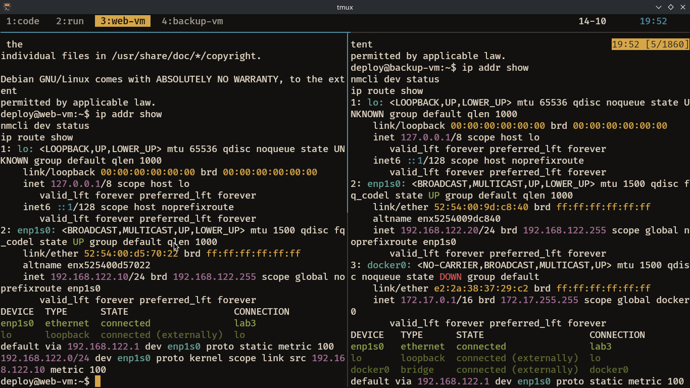
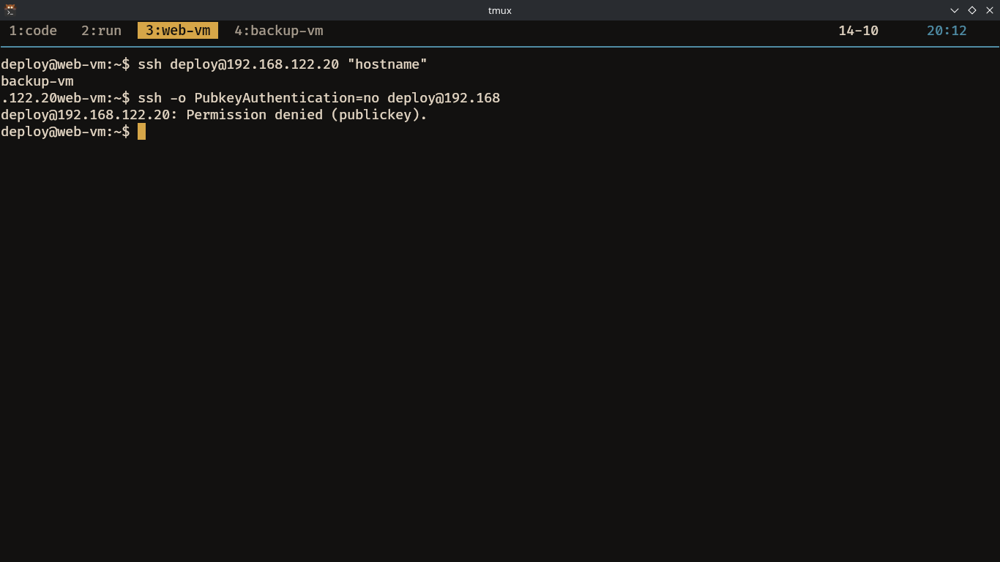
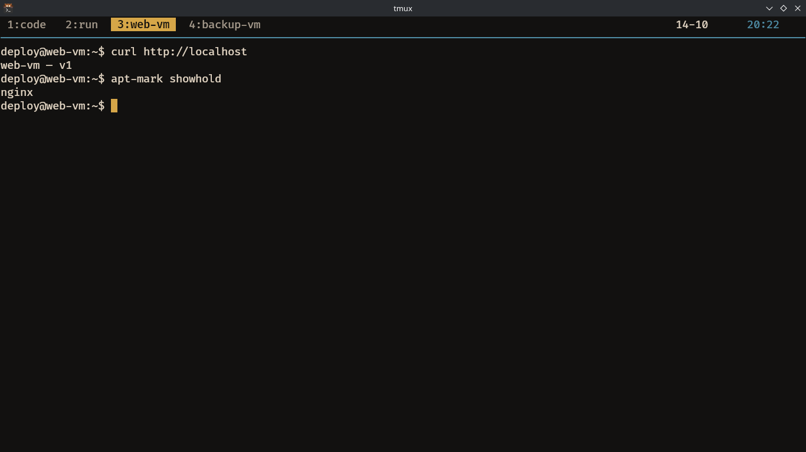
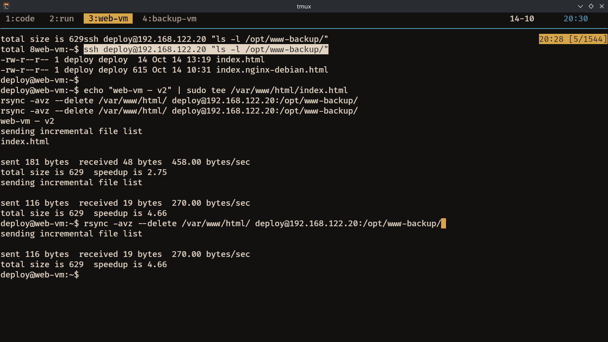
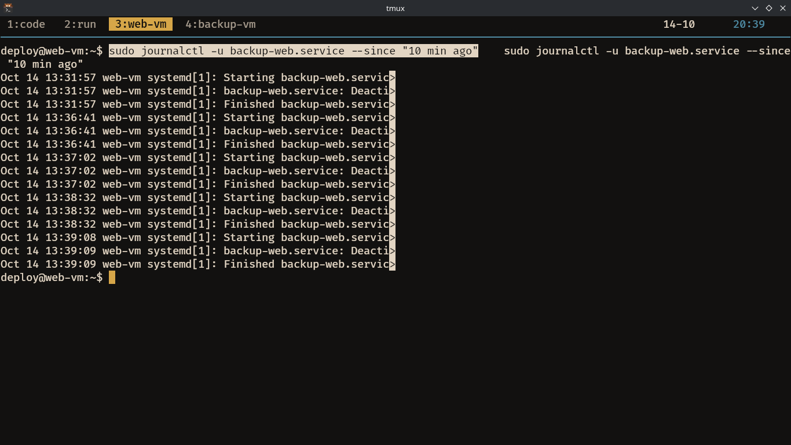

# Lab03

## Environment

Everything below ran on two throwaway libvirt VMs, so this is a reference for reproducing any
command in the report exactly.

| Setting | Value |
|---|---|
| Platform | Debian GNU/Linux 13 (trixie), amd64, KVM guest — both VMs |
| Host | Fedora 43, `qemu:///system`, libvirt net `default` (NAT `192.168.122.0/24`) |
| web-vm | `192.168.122.10` — fresh `virt-install` from `debian-13-generic-amd64.qcow2` with a cloud-init seed |
| backup-vm | `192.168.122.20` — the original `lab02` VM, reused and renamed |
| Gateway / DNS | `192.168.122.1` / `8.8.8.8 1.1.1.1` |
| Shell | `bash` — SSH in as `deploy` (uid 1001, `sudo` NOPASSWD) |
| Network profile | nmcli connection **`lab3`** on both VMs, device `enp1s0` |
| Screenshots | `labs/lab03/screenshots/` |

```text
web-vm (.10, nginx + /var/www/html) ──SSH key :22──> backup-vm (.20, /opt/www-backup)
```

**Deviations from the spec** (slide 2 allows adjusting to the environment):

| Spec | Used | Reason |
|---|---|---|
| Ubuntu 22.04/24.04 | Debian 13 | Debian 13 was the pool's existing base image; `apt`, `apt-mark hold`, `nginx` and `systemd` behave identically |
| Host-only `192.168.56.0/24` | libvirt NAT `192.168.122.0/24` | The available hypervisor is `virsh`/libvirt, not VirtualBox; `.10` and `.20` were free in that range |

---

## Task 01 - Static IP with `nmcli`

> nmcli · NetworkManager · persistence

### Step 1 - Inspect the current state

```bash
# input
ip addr show
nmcli con show
nmcli device status
```

Explain: `ip addr show` tells me what address is on the NIC right now, `nmcli con show` lists
the connection profiles stored on disk, and `nmcli device status` shows which profile is
attached to which device. On both VMs the profile is `lab3` and the device is `enp1s0`. The
`"CON"` in the slide is only a placeholder for whatever `nmcli con show` returns.

### Step 2 - Write the static configuration into the profile

```bash
sudo nmcli con mod "lab3" \
  ipv4.method manual \
  ipv4.addresses 192.168.122.10/24 \
  ipv4.gateway 192.168.122.1 \
  ipv4.dns "8.8.8.8 1.1.1.1"
```

Explain: `con mod` only edits the stored profile; it does not touch the running network. That
separation is the point — I can write a wrong address, see nothing happen, and correct it
before anything goes down.

### Step 3 - Apply it

```bash
sudo nmcli con up "lab3"
```

Explain: This is the moment the kernel actually takes the address. My SSH session dropped here
because the IP changed from DHCP to static, so I had to reconnect to `192.168.122.10`.

### Step 4 - Verify address and route

```bash
ip addr show
ip route show
ping -c3 8.8.8.8
ping -c3 google.com
```

Explain: Two separate checks. `ping -c3 8.8.8.8` proves the gateway and routing work;
`ping -c3 google.com` proves DNS resolution works. If the first succeeds and the second fails,
the address itself is fine and `ipv4.dns` is wrong — a different problem entirely.

### Step 5 - Repeat on backup-vm at `192.168.122.20`

```bash
# input
sudo nmcli con mod "lab3" ipv4.method manual \
  ipv4.addresses 192.168.122.20/24 \
  ipv4.gateway 192.168.122.1 \
  ipv4.dns "8.8.8.8 1.1.1.1"
sudo nmcli con up "lab3"
```

Explain: Task 04's rsync command addresses backup-vm by IP on a schedule. A DHCP address can
change on reboot, so the scheduled backup would silently start failing. Both VMs need fixed
addresses.

### Validation gate — the address survives a reboot

```bash
# input
sudo reboot
# reconnect, then:
ip addr show
nmcli dev status
ip route show
```

Explain: Addresses are persisted. Both VMs came back from `sudo reboot` still holding `.10` and
`.20` on profile `lab3`, with a single static default route and no leftover DHCP address. That
proves `con mod` wrote to the stored profile rather than only configuring the running kernel.



---

## Task 02 - SSH key from web-vm to backup-vm

> ssh-keygen · ssh-copy-id · sshd_config

### Step 1 - Generate an ed25519 key pair on web-vm

```bash
# input
ssh-keygen -t ed25519 -C "web-vm backup"

# output
Generating public/private ed25519 key pair.
Your identification has been saved in /home/deploy/.ssh/id_ed25519
The key fingerprint is:
SHA256:SUQQPA617HwP+EVw7xpsjYOHtdTewNKeu0EtAM7MXCk web-vm backup
```

Explain: I created the ssh key with no passphrase, because if I want automation, I should not
set a passphrase. Task 04's timer runs as a systemd service with no terminal and no agent, so
it cannot type one. A passphrase here would make the hourly backup fail silently forever.

### Step 2 - Copy the public key and test it

```bash
# input
ssh-copy-id deploy@192.168.122.20
ssh deploy@192.168.122.20 "hostname"
```

Explain: `ssh-copy-id` is just an SSH login followed by appending your **public** key to
`~/.ssh/authorized_keys` on the far side. It returned `backup-vm`, so key-only login to
backup-vm works.

### Step 3 - Harden backup-vm's `sshd_config`

```bash
# input
sudo vi /etc/ssh/sshd_config
#   PasswordAuthentication no
#   PermitRootLogin no
sudo sshd -t
sudo systemctl reload ssh
```

Explain: `sshd -t` validates the config syntax and exits without restarting anything, so it is
safe to run before committing. `reload` re-reads the config on the running sshd instead of
dropping existing connections, which is safer than `restart` while I am connected through it.
The key had to be copied and tested *before* this change, otherwise `PasswordAuthentication no`
locks me out of the machine I need in order to fix it.

### Validation gate — key login works, password login refused

```bash
# input
ssh deploy@192.168.122.20 "hostname"
ssh -o PubkeyAuthentication=no deploy@192.168.122.20
```

Explain: `ssh -o PubkeyAuthentication=no` disables publickey for that one attempt. If password
login is still refused *with* pubkey turned off, the refusal cannot be explained by a missing
key — it can only come from `PasswordAuthentication no` doing its job.



---

## Task 03 - Install nginx and pin the version

> apt · apt-mark hold · nginx

### Step 1 - Install and confirm it serves

```bash
# input
sudo apt update
sudo apt install nginx
sudo nginx -v
sudo nginx -t
curl -I http://localhost

# output
HTTP/1.1 200 OK
Server: nginx
Content-Type: text/html
Content-Length: 615
```

Explain: `nginx -v` prints the version, `sudo nginx -t` validates the configuration without
starting anything. The `sudo` is needed because the binary is `/usr/sbin/nginx`, which is not
on a non-root user's PATH — which is why a bare `nginx` returned "command not found" for me
before I noticed that.

### Step 2 - Add the sample content Task 04 backs up

```bash
# input
echo "web-vm — v1" | sudo tee /var/www/html/index.html

# output
web-vm — v1
```

Explain: `tee` instead of `>` because `/var/www/html/index.html` is root-owned, so the shell's
redirect would fail on permission. nginx serves it through the default `root /var/www/html`
directive in `/etc/nginx/sites-enabled/default`.

### Step 3 - Pin the installed version

```bash
# input
sudo apt-mark hold nginx
apt-mark showhold
sudo apt upgrade
```

Explain: `apt-mark hold` pins nginx at its current version and apt will refuse to upgrade it.
Without that, an unattended `apt upgrade` can pull a new nginx release in the middle of the
term and change behaviour under a lab graded on a known version. `apt-mark unhold` releases it.

### Validation gate — page serves, nginx is held

```bash
# input
curl http://localhost
apt-mark showhold
```

Explain: `curl http://localhost` returned `web-vm — v1` and `apt-mark showhold` listed
`nginx`, so both the service and the pin are confirmed.



---

## Task 04a - Back up the web data with rsync

> rsync · --delete · dry run · delta transfer

### Step 1 - Dry run first

```bash
# input
rsync -avz --delete -n /var/www/html/ deploy@192.168.122.20:/opt/www-backup/

# output
sending incremental file list
./
index.html
index.nginx-debian.html

sent 124 bytes  received 32 bytes  104.00 bytes/sec
total size is 629  speedup is 4.03 (DRY RUN)
```

Explain: The trailing slash on `/var/www/html/` copies the *contents* of the directory, not the
directory itself, so `index.html` lands at the top level of the backup rather than inside a
nested `html/`. `-n` is what makes `--delete` safe: without it, a mistyped path would delete
files on backup-vm for real, because `--delete` removes anything on the destination that is
gone from the source.

### Step 2 - The real run

```bash
# input
rsync -avz --delete /var/www/html/ deploy@192.168.122.20:/opt/www-backup/

# output
sent 615 bytes  received 64 bytes  1,358.00 bytes/sec
total size is 629  speedup is 0.93
```

Explain: The first run transfers everything (615 bytes) because the destination is empty —
rsync has no prior state to compare sizes and timestamps against, so it must copy everything
once.

### Step 3 - Verify on backup-vm

```bash
# input
ssh deploy@192.168.122.20 "ls -l /opt/www-backup/"

# output
-rw-r--r-- 1 deploy deploy  14 Oct 14 13:19 index.html
-rw-r--r-- 1 deploy deploy 615 Oct 14 10:31 index.nginx-debian.html
```

Explain: Both files sit directly in `/opt/www-backup/`, which confirms the trailing slash copied
the contents rather than the folder itself.

### Step 4 - Change a file and run again

```bash
# input
echo "web-vm — v2" | sudo tee /var/www/html/index.html
rsync -avz --delete /var/www/html/ deploy@192.168.122.20:/opt/www-backup/
rsync -avz --delete /var/www/html/ deploy@192.168.122.20:/opt/www-backup/

# output
sent 181 bytes  received 48 bytes  458.00 bytes/sec
total size is 629  speedup is 2.75

sent 116 bytes  received 19 bytes  270.00 bytes/sec
total size is 629  speedup is 4.66
```

Explain: 181 bytes against the 615 of the full run. rsync decided that only `index.html` had
changed and re-sent it alone. With `-a` the decision is based on size and modification time,
not content — which is why `--checksum` exists for the case where a file's content changes
without its size or mtime changing.

### Validation gate

Explain: v2 appeared in `/opt/www-backup/index.html` on backup-vm, and the third run with
nothing changed sent only 116 bytes of protocol overhead and no file data at all. That collapse
is the whole point of rsync over a plain copy.



---

## Task 04b - Schedule it with a systemd timer

> systemd · .service · .timer · journalctl

### Step 1 - The backup script

```bash
# input
sudo tee /opt/backup-web.sh >/dev/null <<'EOF'
#!/usr/bin/env bash
rsync -az --delete /var/www/html/ deploy@192.168.122.20:/opt/www-backup/
EOF
sudo chmod +x /opt/backup-web.sh
sudo chown deploy:deploy /opt/backup-web.sh
```

Explain: The script is owned by `deploy` because the SSH key from Task 02 lives in
`deploy`'s `~/.ssh`. Root has a different home directory and cannot see it.

### Step 2 - The two systemd units

```bash
# input
sudo tee /etc/systemd/system/backup-web.service >/dev/null <<'EOF'
[Service]
Type=oneshot
User=deploy
ExecStart=/opt/backup-web.sh
EOF

sudo tee /etc/systemd/system/backup-web.timer >/dev/null <<'EOF'
[Timer]
OnCalendar=hourly
Persistent=true
[Install]
WantedBy=timers.target
EOF
```

Explain: `Type=oneshot` means systemd runs the command once and treats the job as finished,
which is correct for a backup. `User=deploy` is the single line that decides whether this
works at all: a unit defaults to root, and root cannot read `deploy`'s private key, so it
would fail authentication every hour and only show up in the journal. `Persistent=true` makes
systemd run a missed backup immediately after a reboot that landed inside the hourly window.

### Step 3 - Enable and run once

```bash
# input
sudo systemctl daemon-reload
sudo systemctl enable --now backup-web.timer
systemctl list-timers backup-web.timer
sudo systemctl start backup-web.service
sudo journalctl -u backup-web.service
```

Explain: `daemon-reload` re-reads the unit files I just wrote, without which systemd would not
know they exist. `enable --now` starts the timer immediately and also links it to
`timers.target` so it survives reboot. `list-timers` is the proof it is actually scheduled.
`sudo` is required on `journalctl` because a non-root user cannot read another user's unit
output — without it the command reports "No entries" even when the unit did run.

### Validation gate — the timer fires on its own

```bash
# input
# OnCalendar was temporarily set to *-*-* *:*:00 so the unattended run could be observed
# within a minute instead of waiting an hour, then restored to hourly.
echo "web-vm — v3" | sudo tee /var/www/html/index.html
ssh deploy@192.168.122.20 "cat /opt/www-backup/index.html"
sudo journalctl -u backup-web.service --since "10 min ago"
```

Explain: After writing `web-vm — v3` I ran no rsync by hand, and within one timer interval
backup-vm's `/opt/www-backup/index.html` contained v3. `journalctl` showed a run triggered by
the timer rather than by me. I recorded the temporary `OnCalendar` here so the submitted unit
file still reads `hourly`.



---

## History

Cleared immediately before Task 01 so the transcript holds only the lab commands.

```bash
# web-vm
    1  export HISTTIMEFORMAT='%F %T '
    2  history
    3  ip addr show
    4  nmcli con show
    5  nmcli device status
    6  nmcli con show
    7  nmcli device status
    8  sudo nmcli con mod "lab3"   ipv4.method manual   ipv4.addresses 192.168.122.10/24   ipv4.gateway 192.168.122.1   ipv4.dns "8.8.8.8 1.1.1.1"
    9  sudo nmcli con up "lab3"
   10  ip addr show
   11  ip route show
   12  ping -c 8.8.8.8
   13  ping -c3 8.8.8.8
   14  ping -c3 google.com
   15  sudo reboot
   16  ip addr show
   17  nmcli dev status
   18  ip route show
   19  ssh-keygen -t ed25519 -C "web-vm backup"
   20  rm -rf ~/.ssh/id_ed25519*
   21  ssh-keygen -t ed25519 -C "web-vm backup"
   22  ssh-copy-id deploy@192.168.122.20
   23  ssh deploy@192.168.122.20 "hostname"
   24  ssh-copy-id deploy@192.168.122.20
   25  cat ~/.ssh/id_ed25519.pub
   26  ssh-copy-id deploy@192.168.122.20
   27  ssh deploy@192.168.122.20 "hostname"
   28  ssh -o PubkeyAuthentication=no deploy@192.168.122.20
   29  ssh deploy@192.168.122.20 "hostname"
   30  ssh -o PubkeyAuthentication=no deploy@192.168.122.20
   31  sudo apt install nginx
   32  sudo apt update
   33  sudo apt install nginx
   34  nginx -v
   35  sudo apt install nginx
   36  nginx
   37  /usr/bin/nginx
   38  ls -l /usr/sbin/nginx
   39  /usr/sbin/nginx -v
   40  sudo nginx -t
   41  nginx -t
   42  sudo nginx -t
   43  nginx -v
   44  sudo nginx -v
   45  curl -I http://localhost
   46  echo "web-vm — v1" | sudo tee /var/www/html/index.html
   47  sudo apt-mark hold nginx
   48  apt-mark showhold
   49  sudo apt upgrade
   50  curl http://localhost
   51  apt-mark showhold
   52  rsync -avz --delete -n /var/www/html/ deploy@192.168.122.20:/opt/www-backup/
   53  rsync -avz --delete /var/www/html/ deploy@192.168.122.20:/opt/www-backup/
   54  ssh deploy@192.168.122.20 "ls -l /opt/www-backup/"
   55  echo "web-vm — v2" | sudo tee /var/www/html/index.html
   56  rsync -avz --delete /var/www/html/ deploy@192.168.122.20:/opt/www-backup/
   57  sudo tee /opt/backup-web.sh >/dev/null <<'EOF'
#!/usr/bin/env bash
rsync -az --delete /var/www/html/ deploy@192.168.122.20:/opt/www-backup/
EOF

   58  sudo chmod +x /opt/backup-web.sh
   59  sudo chown deploy:deploy /opt/backup-web.sh
   60  sudo tee /etc/systemd/system/backup-web.service >/dev/null <<'EOF'
[Service]
Type=oneshot
User=deploy
ExecStart=/opt/backup-web.sh
EOF

   61  sudo tee /etc/systemd/system/backup-web.timer >/dev/null <<'EOF'
[Timer]
OnCalendar=hourly
Persistent=true
[Install]
WantedBy=timers.target
EOF

   62  sudo systemctl daemon-reload
   63  sudo systemctl enable --now backup-web.timer
   64  systemctl list-timers backup-web.timer
   65  sudo systemctl start backup-web.service
   66  journalctl -u backup-web.service
   67  sudo journalctl -u backup-web.service
   68  sudo systemctl list-timers backup-web.timer
   69  sudo sed -i 's/^OnCalendar=hourly/OnCalendar=*-*-* *:*:00/' /etc/systemd/system/backup-web.timer
   70  sudo systemctl daemon-reload
   71  sudo systemctl restart backup-web.timer
   72  systemctl list-timers backup-web.timer
   73  echo "web-vm — v3" | sudo tee /var/www/html/index.html
   74  ssh deploy@192.168.122.20 "cat /opt/www-backup/index.html"
   75  journalctl -u backup-web.service
   76  sudo journalctl -u backup-web.service --since "10 min ago"
   77  history
```

```bash
# backup-vm
    1  export HISTTIMEFORMAT='%F %T '
    2  history
    3  ip addr show
    4  nmcli con show
    5  nmcli device status
    6  sudo nmcli con mod "lab3" ipv4.method manual   ipv4.addresses 192.168.122.20/24   ipv4.gateway 192.168.122.1   ipv4.dns "8.8.8.8 1.1.1.1"
    7  sudo nmcli con up "lab3"
    8  sudo reboot
    9  ip addr show
   10  nmcli dev status
   11  ip route show
   12  echo 'ssh-ed25519 AAAAC3NzaC1lZDI1NTE5AAAAICqqRASvb86eaFfQgvKWy0rapZ7NODjh4a5G74/oSAE3 web-vm backup' >>  ~/.ssh/authorized_keys
   13  chmod 700 ~/.ssh
   14  chmod 600 ~/.ssh/authorized_keys
   15  sudo vi /etc/ssh/sshd_config
   16  sudo sshd -t
   17  sudo systemctl reload ssh
   18  history
```

---

## Questions (in report)

- Which step broke first, and how did you diagnose it? (slide 8)

**Answer:** The first thing to break was `ssh-copy-id` in Task 02. It printed
`INFO: 1 key(s) remain to be installed -- if you are prompted now it is to install the new
keys` and then failed with `deploy@192.168.122.20: Permission denied (publickey)`. That
second line was the clue: it listed publickey as the *only* method the server would still
accept, which meant the key itself was fine and the failure was happening earlier, in
ssh-copy-id's first phase — logging in with a **password** in order to filter out keys that
were already installed. I re-ran the command and then checked the server's configuration
with `grep -rn PasswordAuthentication /etc/ssh/`, which returned a single hit:
`/etc/ssh/sshd_config:57:PasswordAuthentication no`. That pointed at password authentication
having already been disabled on backup-vm, so ssh-copy-id could never complete its login and
therefore never appended the key — and there was no `sshd_config.d/` drop-in, so the setting
had been written into the main `sshd_config` by my own earlier edit, which is why the current
`history` (cleared just before Task 01) did not show it. I fixed it by bypassing ssh-copy-id
altogether: I read the key with `cat ~/.ssh/id_ed25519.pub` on web-vm, appended that line to
`~/.ssh/authorized_keys` on backup-vm from its console, and set the permissions to `700` on
`~/.ssh` and `600` on `authorized_keys`. That route does not depend on password
authentication at all, so it succeeds whatever `sshd_config` says, and only after the key was
installed did I edit `PasswordAuthentication no` and `PermitRootLogin no`, run `sudo sshd -t`
and reload — which is the ordering the slide warns about, and the reverse of what I had
done the first time.
