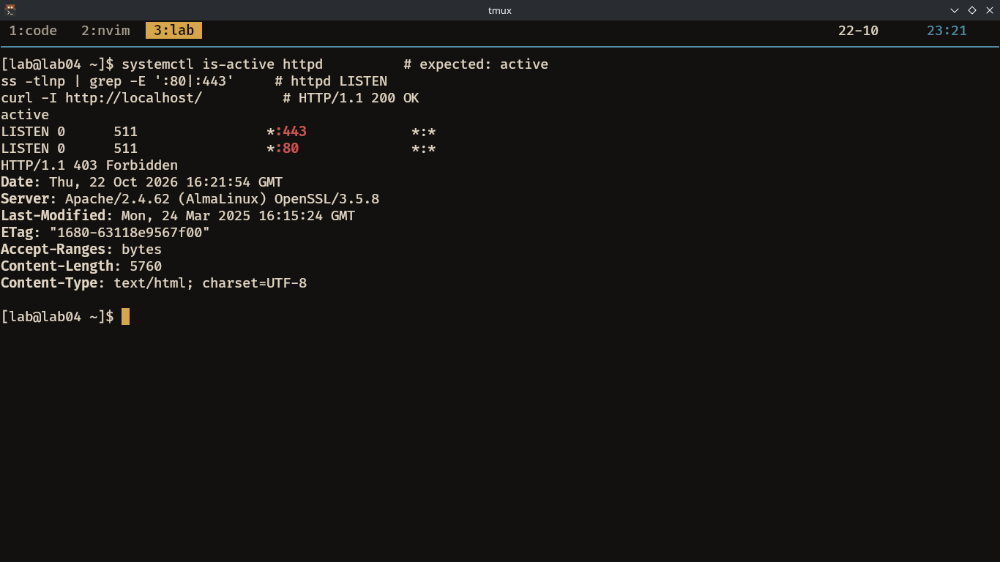
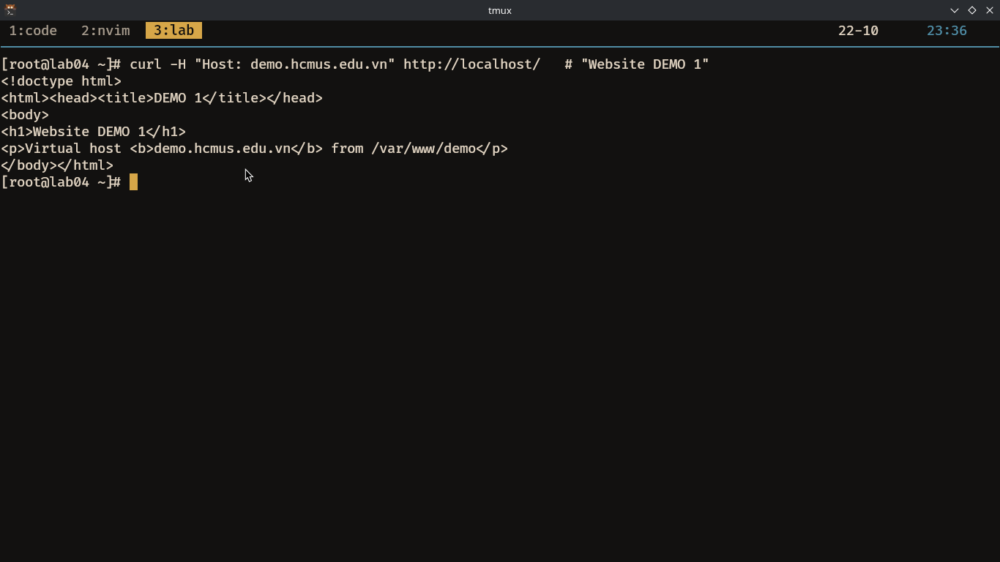
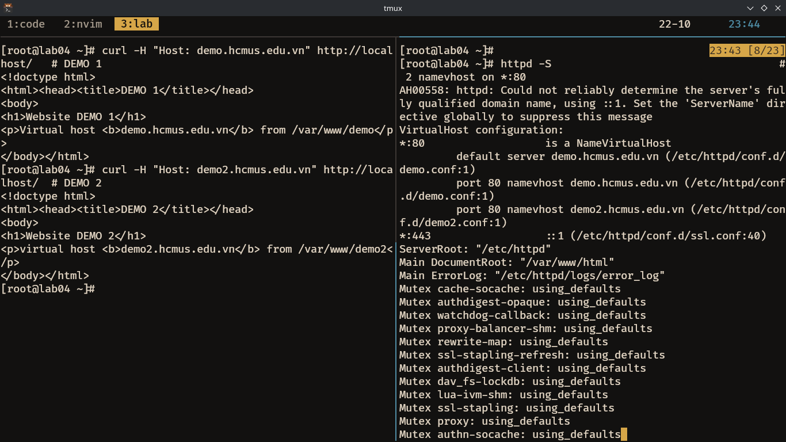
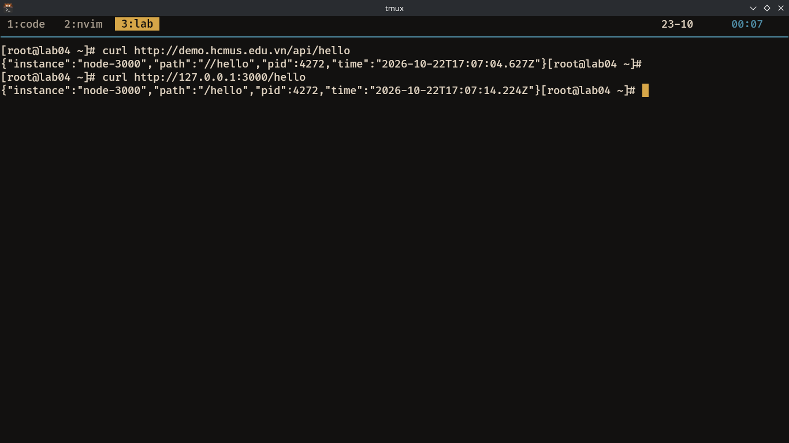
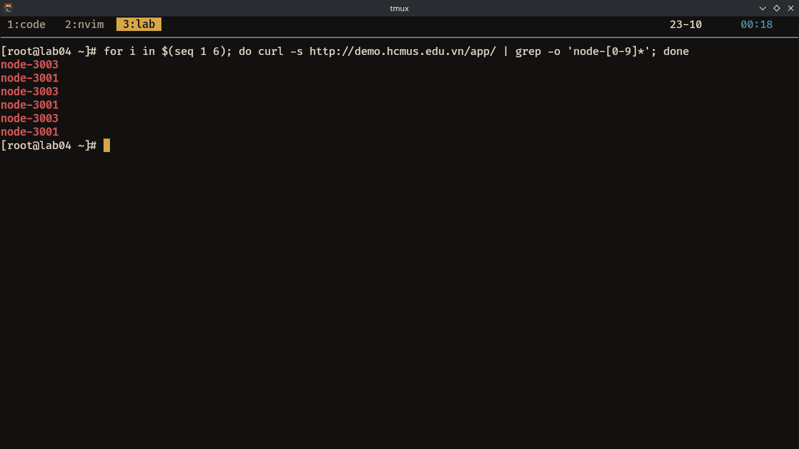
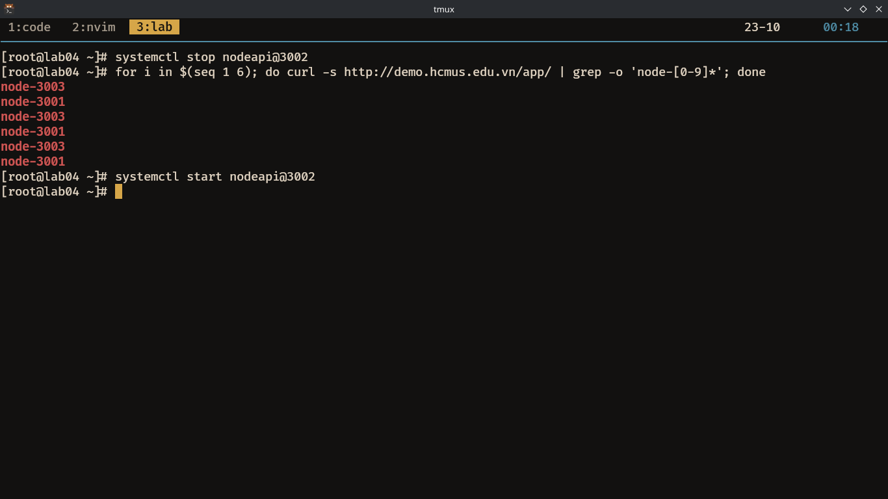
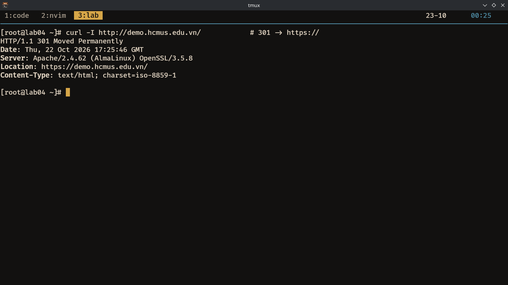
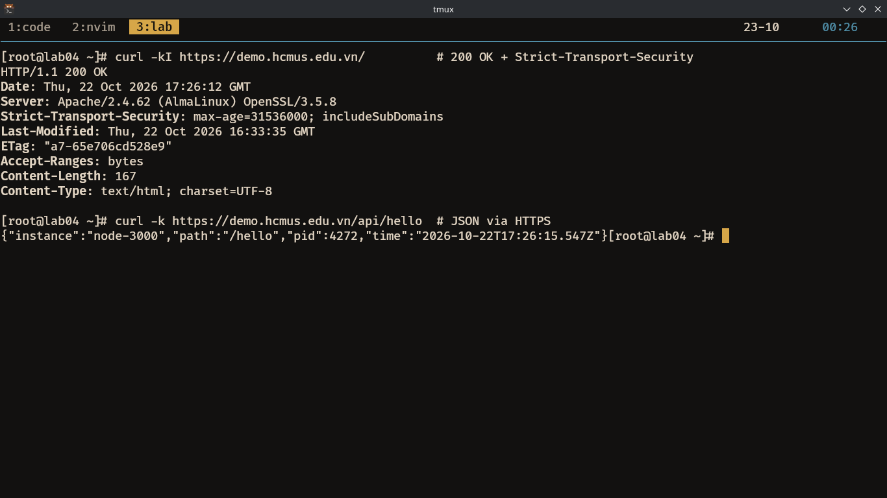
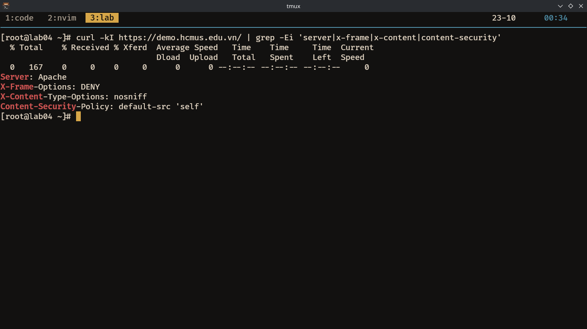

# Lab 04 Report — Deploying an Apache Web Server on Linux

**Student:** Đỗ Công Hưng
**Student ID:** 24120320
**Date:** 22/10/2026
**VM IP:**  192.168.122.52

## 0. Environment

- OS: AlmaLinux 9 (RHEL/CentOS-compatible), SELinux Enforcing
- Hosts entries (VM `/etc/hosts`): `127.0.0.1 demo.hcmus.edu.vn demo2.hcmus.edu.vn`
- Verification: `ping -c1 demo.hcmus.edu.vn` → 
```bash

PING localhost4.localdomain4 (127.0.0.1) 56(84) bytes of data.
64 bytes from localhost (127.0.0.1): icmp_seq=1 ttl=64 time=0.058 ms

--- localhost4.localdomain4 ping statistics ---
1 packets transmitted, 1 received, 0% packet loss, time 0ms
rtt min/avg/max/mdev = 0.058/0.058/0.058/0.000 ms`

```
```bash
ip -4 addr show | grep inet

# output

inet 127.0.0.1/8 scope host lo
inet 192.168.122.52/24 brd 192.168.122.255 scope global dynamic noprefixroute eth0

```

## A. Install & baseline

**Commands run:**
```bash
sudo dnf install -y httpd mod_ssl policycoreutils-python-utils
sudo systemctl enable --now httpd
sudo firewall-cmd --permanent --add-service=http --add-service=https
sudo firewall-cmd --reload
```

**Verification:**
```bash
systemctl is-active httpd          # expected: active
ss -tlnp | grep -E ':80|:443'     # httpd LISTEN
curl -I http://localhost/          # HTTP/1.1 403 forbidden
```



**Notes / explanation:** httpd is active, I have opened 2 ports (80 for http, 443 for https), curl -I localhost got 403 forbidden. 403 is normal for my current setup.

## B. First virtual host (demo)

**Commands run:**
```bash
mkdir -p /var/www/demo
cat > /var/www/demo/index.html << 'EOF'
<!doctype html>
<html><head><title>DEMO 1</title></head>
<body>
<h1>Website DEMO 1</h1>
<p>Virtual host <b>demo.hcmus.edu.vn</b> from /var/www/demo</p>
</body></html>
EOF

# create /var/www/demo/index.html (DEMO 1)
chown -R root:apache /var/www/demo
chmod -R 750 /var/www/demo

semanage fcontext -a -t httpd_sys_content_t "/var/www/demo(/.*)?"
restorecon -Rv /var/www/demo

tee /etc/httpd/conf.d/demo.conf <<'EOF'
<VirtualHost *:80>
ServerName demo.hcmus.edu.vn
DocumentRoot /var/www/demo
<Directory /var/www/demo>
Options -Indexes +FollowSymLinks
AllowOverride None
Require all granted
</Directory>
ErrorLog /var/log/httpd/demo_error.log
CustomLog /var/log/httpd/demo_access.log combined
</VirtualHost>
EOF

# create /etc/httpd/conf.d/demo.conf
sudo apachectl configtest
sudo systemctl reload httpd
```

**Verification:**
```bash
curl -H "Host: demo.hcmus.edu.vn" http://localhost/   # "Website DEMO 1"
```

<!-- PASTE: output -->


**Notes / explanation:** I set up a virtual host for demo.hcmus.edu.vn

## C. Second virtual host (demo2)

**Commands run:** (same pattern, port 80, ServerName demo2.hcmus.edu.vn, DocumentRoot /var/www/demo2)
```bash
mkdir -p /var/www/demo2
cat > /var/www/demo2/index.html << 'EOF'
<!doctype html>
<html><head><title>DEMO 2</title></head>
<body>
<h1>Website DEMO 2</h1>
<p>virtual host <b>demo2.hcmus.edu.vn</b> from /var/www/demo2</p>
</body></html>
EOF

chown -R root:apache /var/www/demo2
chmod -R 750 /var/www/demo2
semanage fcontext -a -t httpd_sys_content_t "/var/www/demo2(/.*)?"
restorecon -Rv /var/www/demo2

tee /etc/httpd/conf.d/demo2.conf <<'EOF'
<VirtualHost *:80>
ServerName demo2.hcmus.edu.vn
DocumentRoot /var/www/demo2

<Directory /var/www/demo2>
Options -Indexes +FollowSymLinks
Require all granted
</Directory>

ErrorLog /var/log/httpd/demo2_error.log
CustomLog /var/log/httpd/demo2_access.log combined
</VirtualHost>
EOF

apachectl configtest && systemctl reload httpd
```

**Verification:**
```bash
httpd -S                                    # 2 namevhost on *:80
curl -H "Host: demo.hcmus.edu.vn" http://localhost/   # DEMO 1
curl -H "Host: demo2.hcmus.edu.vn" http://localhost/  # DEMO 2
```

<!-- PASTE: output -->


**Notes / explanation:** Apache distinguishes sites by the `Host:` header, not by directory. So we can `curl` to the same address but with different `Host: ` then get different contents.

## D. Node API backend + reverse proxy (/api)

**Commands run:**
```bash
dnf install -y nodejs
mkdir -p /opt/api
cat > /opt/api/app.js << 'EOF'
const http = require('http');
const port = process.argv[2] || 3000;
http.createServer((req, res) => {
res.setHeader('Content-Type', 'application/json');
res.end(JSON.stringify({
instance: `node-${port}`,
path: req.url,
pid: process.pid,
time: new Date().toISOString()
}));
}).listen(port, '127.0.0.1', () => console.log(`API on 127.0.0.1:${port}`));
EOF
chown -R apache:apache /opt/api

tee /etc/systemd/system/nodeapi@.service <<'EOF'
[Unit]
Description=Node API on port %i
After=network.target

[Service]
ExecStart=/usr/bin/node /opt/api/app.js %i
Restart=always
User=apache
WorkingDirectory=/opt/api

[Install]
WantedBy=multi-user.target
EOF

systemctl daemon-reload
systemctl enable --now nodeapi@3000
 # backend for /api
ss -tlnp | grep 3000
 # Listening at 127.0.0.1:3000
curl http://127.0.0.1:3000/hello
setsebool -P httpd_can_network_connect 1
```

**Verification:**
```bash
ss -tlnp | grep 3000
curl http://127.0.0.1:3000/hello

# add proxy pass
vi /etc/httpd/conf.d/demo.conf
# add
    ProxyPreserveHost On
    ProxyPass
     /api http://127.0.0.1:3000/
    ProxyPassReverse /api http://127.0.0.1:3000/


# run
apachectl configtest && systemctl reload http

curl http://demo.hcmus.edu.vn/api/hello
```




**Notes / explanation:** Backend binds only to 127.0.0.1; all traffic goes through Apache (proxy pass), this is the security point of reverse proxy.

## E. Load balancer (pool of 3 + failover)

**Commands run:**
```bash
systemctl enable --now nodeapi@3001 nodeapi@3002 nodeapi@3003
# add balancer://appcluster to demo.conf

vi /etc/httpd/conf.d/demo.conf
# add content
    <Proxy balancer://appcluster>
    BalancerMember http://127.0.0.1:3001
    BalancerMember http://127.0.0.1:3002
    BalancerMember http://127.0.0.1:3003
    ProxySet lbmethod=byrequests
    </Proxy>
    ProxyPass
     /app balancer://appcluster/
    ProxyPassReverse /app balancer://appcluster/

apachectl configtest && systemctl reload httpd

```

**Verification — round-robin:**
```bash
for i in $(seq 1 6); do curl -s http://demo.hcmus.edu.vn/app/ | grep -o 'node-[0-9]*'; done
```

**Verification — failover:**
```bash
systemctl stop nodeapi@3002
for i in $(seq 1 6); do curl -s http://demo.hcmus.edu.vn/app/ | grep -o 'node-[0-9]*'; done
systemctl start nodeapi@3002
```

<!-- PASTE: both outputs -->



**Notes / explanation:** Apache distributes incoming requests across the three backend Node instances (ports 3001–3003) using byrequests balancing. When one instance is stopped, Apache detects it and skips it, so requests continue to be served by the remaining live instances without client-visible errors.

## F. SSL/TLS (HTTPS) + redirect + HSTS

**Commands run:**
```bash
openssl req -x509 -nodes -newkey rsa:2048 -days 365 \
  -keyout /etc/pki/tls/private/demo.key \
  -out /etc/pki/tls/certs/demo.crt \
  -subj "/C=VN/ST=HCM/L=HCMC/O=HCMUS/CN=demo.hcmus.edu.vn"
# rewrite demo.conf: :80 redirect, :443 vhost with SSL + HSTS + proxy
apachectl configtest && systemctl reload httpd
```

**Verification:**
```bash
curl -I http://demo.hcmus.edu.vn/            # 301 -> https://
curl -kI https://demo.hcmus.edu.vn/          # 200 OK + Strict-Transport-Security
curl -k https://demo.hcmus.edu.vn/api/hello  # JSON via HTTPS
```




**Notes / explanation:** Used a self-signed certificate to enable HTTPS. Port 80 now only redirects (301) to HTTPS. The :443 vhost serves the site with TLS 1.2/1.3 and sends HSTS so browsers use HTTPS automatically. curl -k ignores the self-signed cert warning.

## G. Firewall & SELinux hardening

**Commands run:**
```bash
firewall-cmd --list-services
firewall-cmd --list-all
getenforce
getsebool httpd_can_network_connect

# edit /etc/httpd/conf.d/hardening.conf
vi /etc/httpd/conf.d/hardening.conf

# add
    ServerTokens Prod
    ServerSignature Off
    TraceEnable Off

    <IfModule mod_headers.c>
    Header always set X-Frame-Options "DENY"
    Header always set X-Content-Type-Options "nosniff"
    Header always set Content-Security-Policy "default-src 'self'"
    </IfModule>

apachectl configtest && systemctl reload httpd
```

**Verification:**
```bash
curl -kI https://demo.hcmus.edu.vn/ | grep -Ei 'server|x-frame|x-content|content-security'
```



**Notes / explanation:** <...>

## Total checklist

| # | Item | Verification command | Result |
|---|------|---------------------|--------|
| 1 | Apache running | `systemctl is-active httpd` | <active> |
| 2 | Firewall open | `firewall-cmd --list-services` | <http https> |
| 3 | Vhost 1 | `curl -k https://demo.hcmus.edu.vn/` | <DEMO 1> |
| 4 | Vhost 2 | `curl -H "Host: demo2..." http://localhost/` | <DEMO 2> |
| 5 | Reverse proxy | `curl -k https://.../api/hello` | <JSON node-3000> |
| 6 | Load balancer | loop `.../app/` | <node-3001/2/3> |
| 7 | Failover | stop one node, loop | <no error, 2 nodes> |
| 8 | HTTPS redirect | `curl -I http://...` | <301 to https> |
| 9 | SELinux | `getenforce` | <Enforcing> |
| 10 | Hardening | `curl -kI https://.../` | <Server: Apache + 3 headers> |

## Submitted artifacts

- `/etc/httpd/conf.d/demo.conf`
- `/etc/httpd/conf.d/demo2.conf`
- `/etc/httpd/conf.d/hardening.conf`
- `/etc/systemd/system/nodeapi@.service`
- `/opt/api/app.js`
- `/var/www/demo/index.html`
- `/var/www/demo2/index.html`
- `/etc/pki/tls/certs/demo.crt`, `/etc/pki/tls/private/demo.key`

## Incident report

**Symptom:** `curl -I localhost` revceive 403 forbidden.

**Reproduction:** `curl -I localhost`

**Logs captured:** I caputured in the image.

**Root cause:** This is the default setting of my setup. It is not similar to CentOS

**Lessons learned:** Make sure that you check your setup before trying anything, not every OS is the the same
