# Report — Lab 10: Bash Scripting & Automation (placeholder)

**Student:** Đỗ Công Hưng  
**Student ID:** 24120320  
**VM IP:** 192.168.122.90  
**Host:** web01

## 0. Environment

- OS: AlmaLinux 9 (CentOS-compatible), SELinux Enforcing
- Services checked: `sshd`, `crond` (`systemctl is-active`)
- shellcheck installed via `dnf install epel-release && dnf install ShellCheck`
- Backup destination: Option B — `DEST="/srv/backup-target"` (local dir as remote target)
- Mail mode: `MAIL_MODE="file"` → `/var/log/web01-mail.log` (no SMTP relay available)
- Config files (not submitted, root-owned, mode 600): `/etc/monitoring.env`, `/etc/backup.env`
- Data path: `/home/lab/web01-data` (no `~` in config)
- No secrets submitted in the `.zip`

## Task 1 — Health-check (2.5)

Acceptance evidence:

- Healthy host: `./health-check.sh` prints nothing, exits `0`.
  - 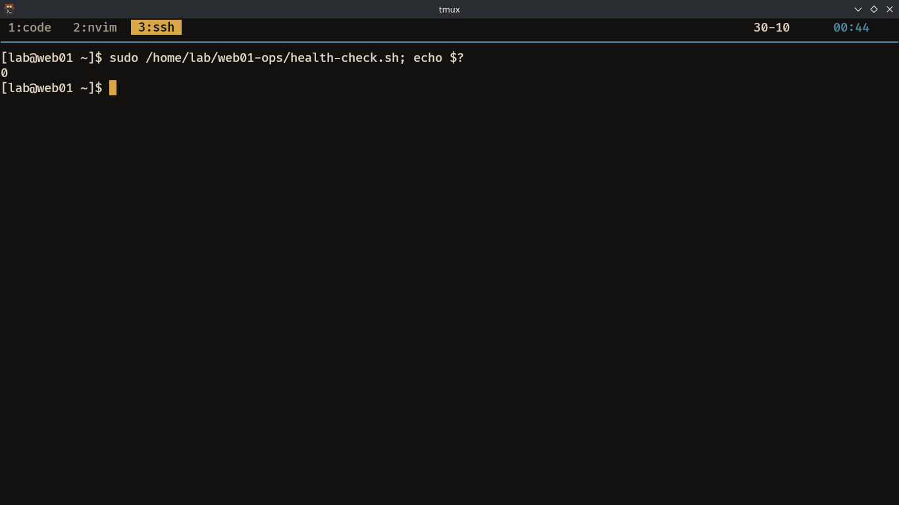
- Single failure exactly one mail (threshold lowered OR endpoint stopped).
  - 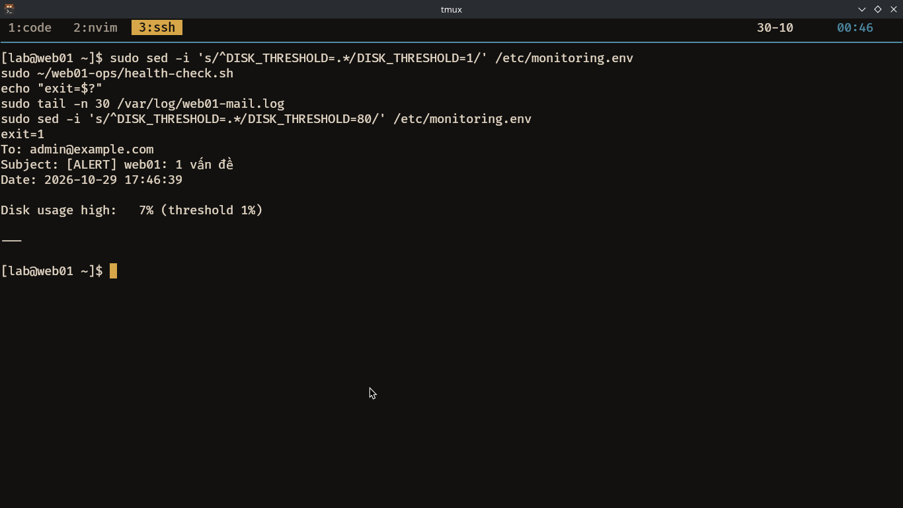
- Multiple failures in one mail (`DISK_THRESHOLD=1` and `/health` down); proves all checks still run.
  - 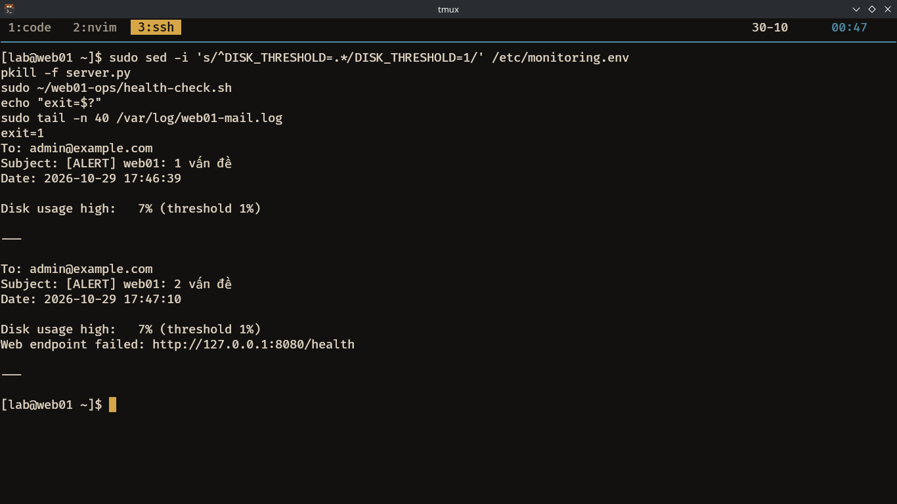
- Mail subject contains hostname and count: `[ALERT] web01: 2 vấn đề`; body lists every finding + timestamp.

## Task 2 — Backup & restore test (2.5)

Acceptance evidence:

- Successful run creates `web01-backup-YYYYmmdd-HHMMSS.tar.gz` at `$DEST`, with archive name, size, destination.
  - 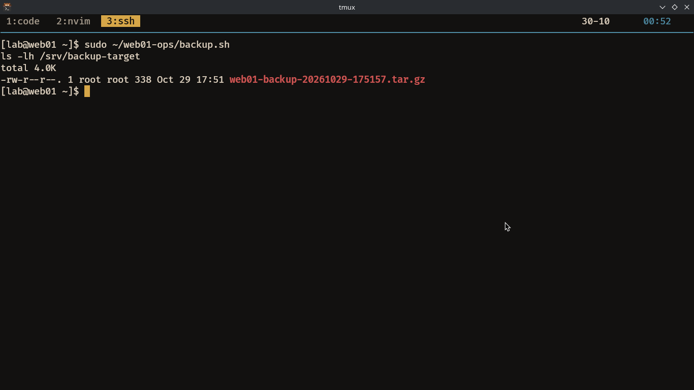
- Rotation: stale archives removed, new one retained.
  - Before: 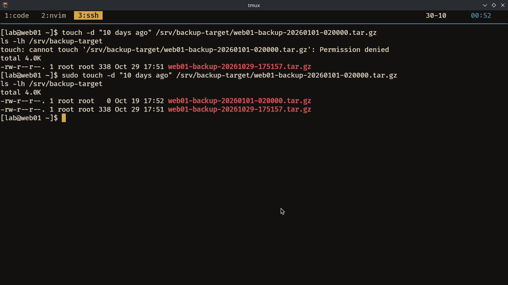
  - After: 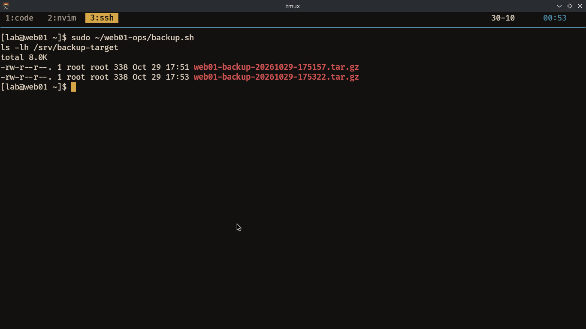
- Archive content proves `manifest.txt` present and no `access.log`, `cache.tmp`.
  - 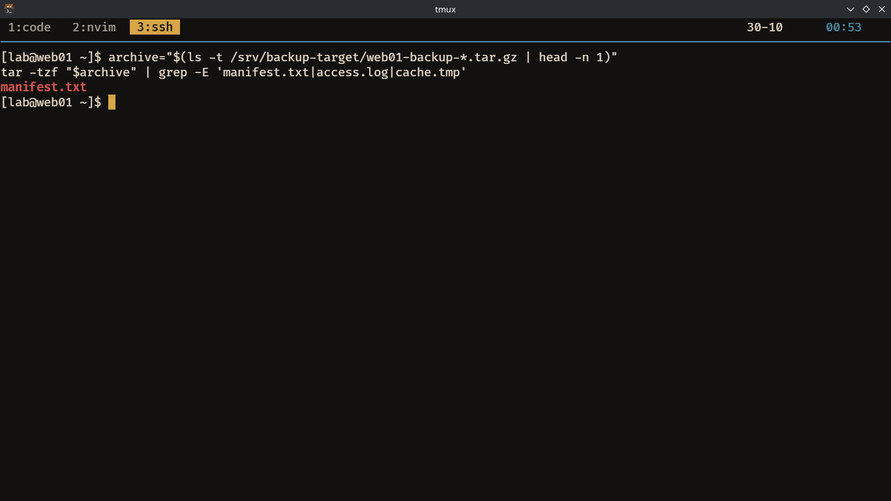
- Restore verification reports all files OK in `N/N file OK` format.
  - 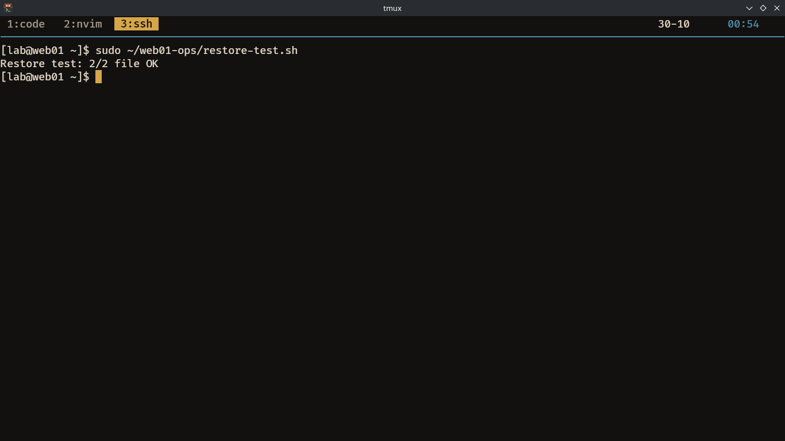
- Simulated failure (`DATA_DIR` invalid): trap sends `BACKUP FAILED`, temp dir removed; shows `/tmp` before/after.
  - 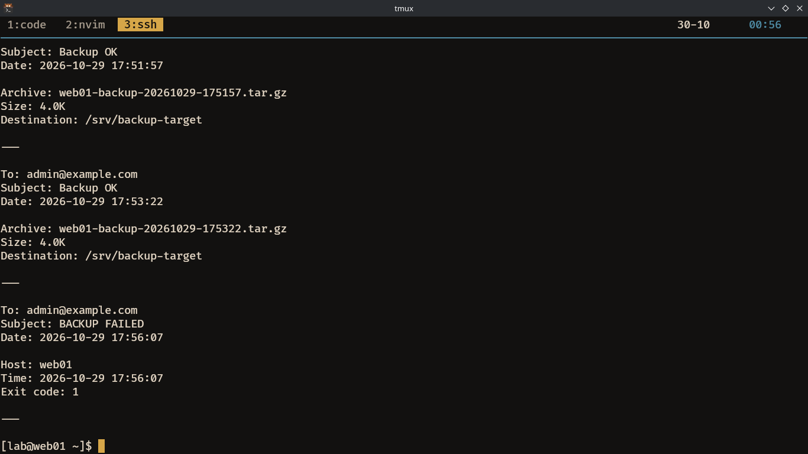
  - Before: 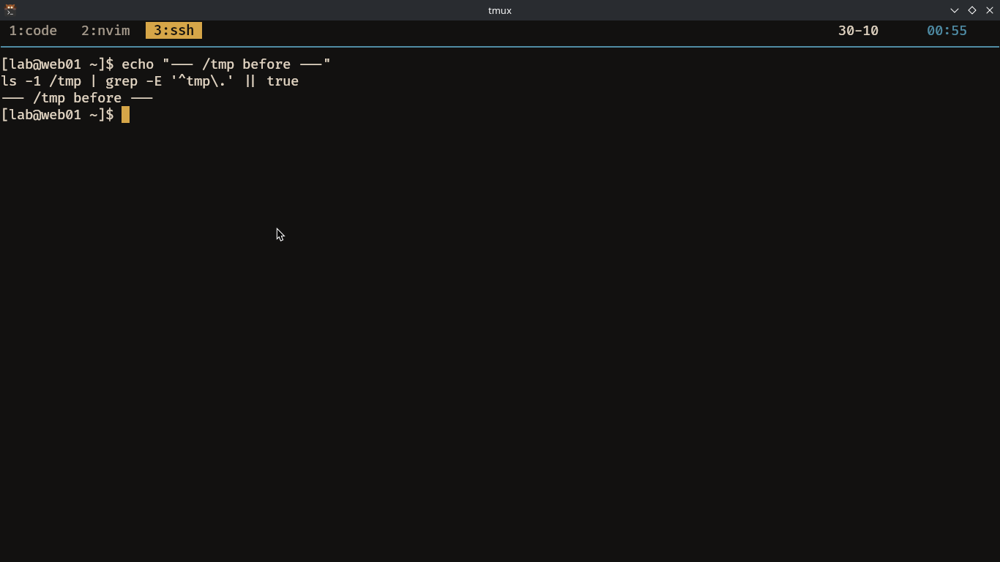
  - After: 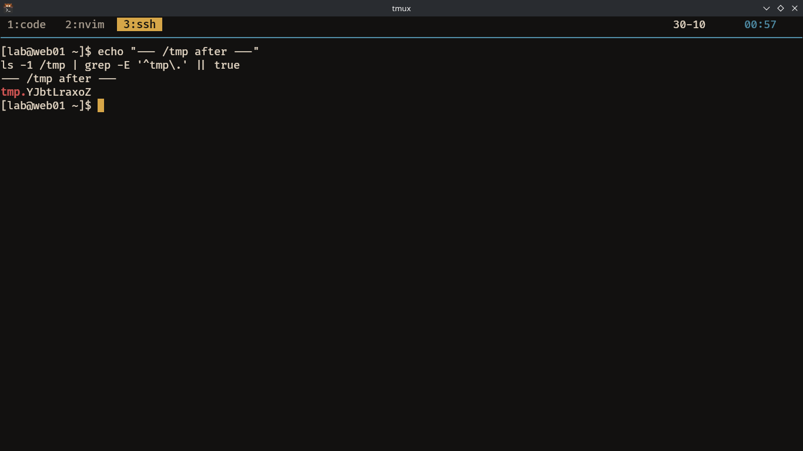

## Task 3 — Error trap & shellcheck (2.0)

Acceptance evidence:

- Intentional error stops at the exact line; following line (`DÒNG NÀY KHÔNG ĐƯỢC IN RA`) is not printed.
  - 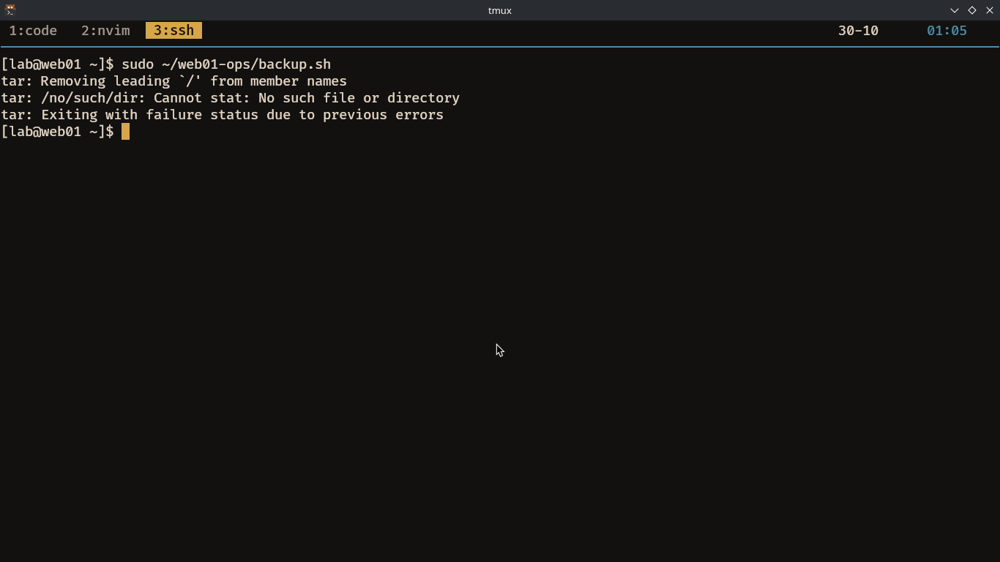
- Alert email contains line number, command, exit code, hostname.
  - 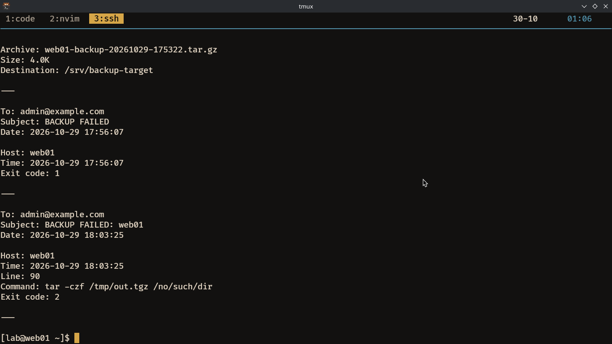
- shellcheck cleaned before/after output (`shellcheck *.sh` with no warnings).
  - Before: 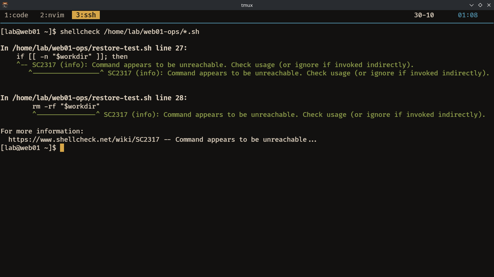
  - After: 

## Task 4 — Cron (1.5)

Acceptance evidence:

- Cron configuration using `/etc/cron.d/web01-ops` (or root crontab) with `PATH`, absolute paths, both jobs.
  - 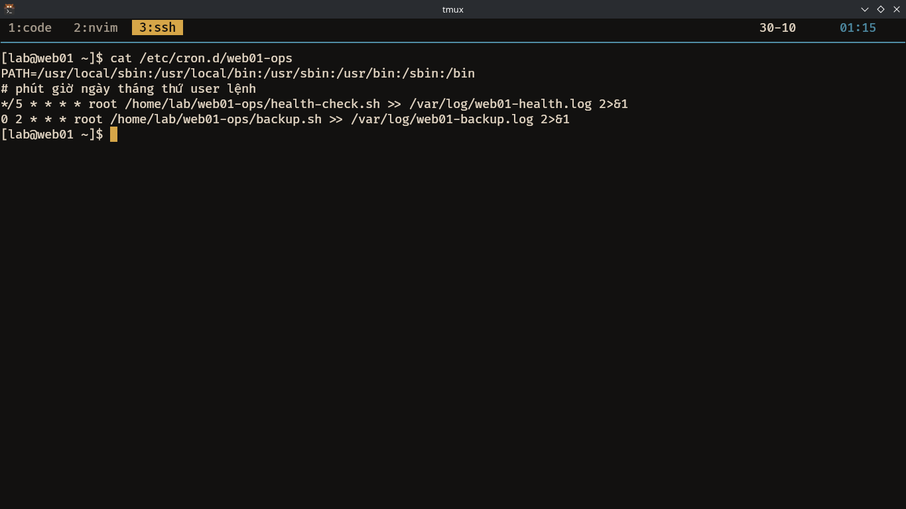
- Temporary `*/1` health-check run for several minutes, then restored to `*/5`.
  - Evidence: `cron/web01-ops`
- Logs show scheduled runs and one incident email.
  - Journal: 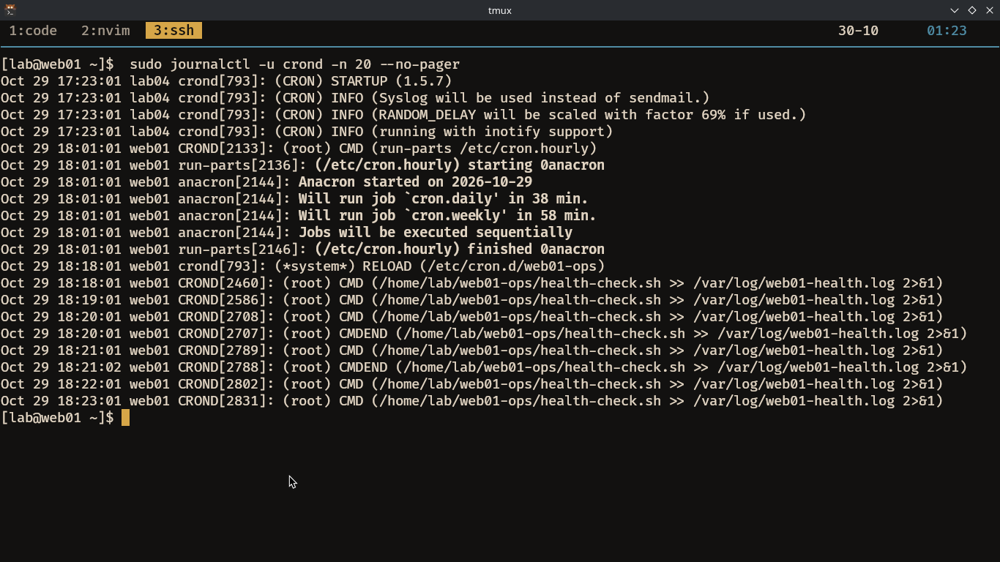
  - Incident: 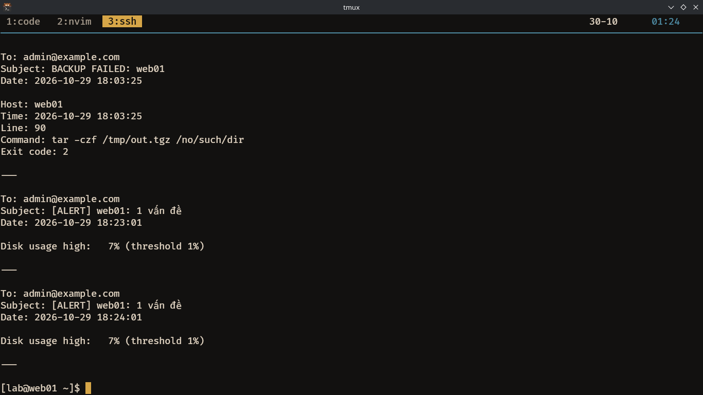
- Note: cron fails when PATH/cwd/`~`/permissions/env are assumed from interactive shell; mitigated by absolute paths, explicit `PATH`, root job, and sourcing `/etc/*.env`.

## Notes

- Mail uses file mode because no SMTP relay was available; inspect `/var/log/web01-mail.log`.
- Backup uses Option B, so restore verification is local; switch `DEST`/`rsync` for Option A on a second VM.
- Config examples must use fake values only; real `/etc/*.env` stays outside the `.zip`.
- Screenshot name `screenshots/task1-multi.png` contains multi-failure evidence; ideally rename it to `screenshots/task1-multi.png`.
- `task3-shellcheck-after` evidence captured and added (clean run).
